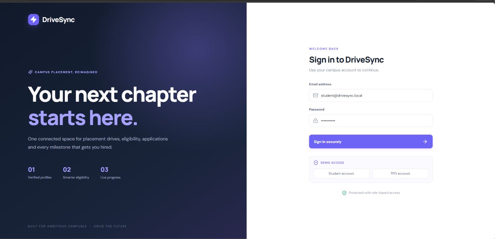
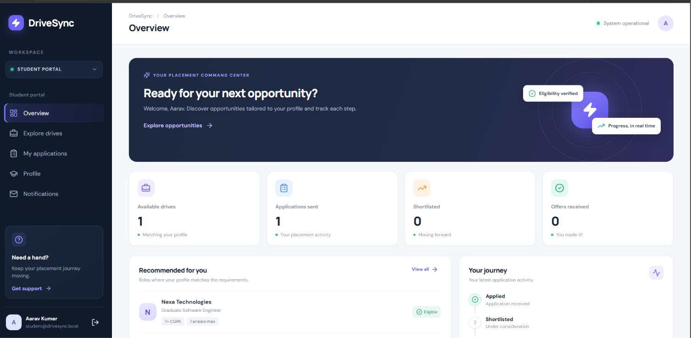
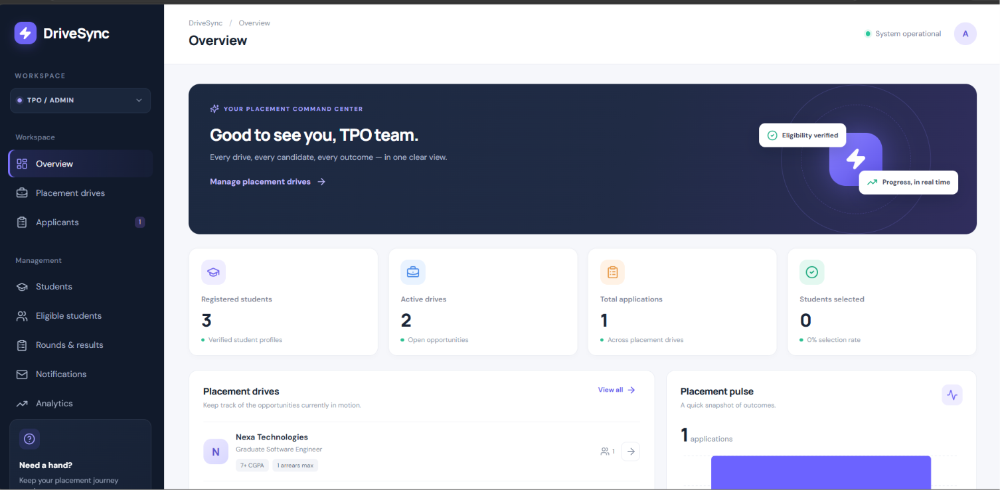

# DriveSync — Placement Drive Coordination System

React 18 + Vite frontend, Java 21 / Spring Boot 3.5.5 backend, Spring Security HTTP Basic, Spring Data JPA/Hibernate, MySQL, Maven, Apache POI and Lombok.

## Features in this source package
- Student and TPO dashboards, login and role-protected APIs.
- Drive management, Excel student import, eligibility filtering by CGPA/branch/arrears and backend application eligibility checks.
- Duplicate application prevention and student application history.
- Per-drive custom questions, saved application answers and Excel export.
- Placement rounds, round results and application lifecycle statuses.
- TPO analytics and notification logs.
- Optional email and Twilio SMS integrations (disabled/test mode by default).

## Deploy online
The deployment target is **Vercel (frontend) + Render (backend) + external managed MySQL**. Follow the full instructions in [`docs/DEPLOY-VERCEL-RENDER.md`](docs/DEPLOY-VERCEL-RENDER.md). The repository includes `render.yaml`, `backend/Dockerfile`, and `frontend/vercel.json`.

## Local development (Windows)
Prerequisites: JDK 21 or later, Maven 3.9+, Node.js 20+, npm and MySQL 8+.

1. Create the database `drivesync` in MySQL.
2. In PowerShell, set local environment values and run the backend:

```powershell
$env:DB_URL="jdbc:mysql://localhost:3306/drivesync?createDatabaseIfNotExist=true&useSSL=false&allowPublicKeyRetrieval=true&serverTimezone=UTC"
$env:DB_USERNAME="root"
$env:SPRING_DATASOURCE_PASSWORD="YOUR_MYSQL_PASSWORD"
$env:SERVER_PORT="8082"
$env:FRONTEND_ORIGIN="http://localhost:5173"
$env:SEED_DEMO_DATA="true"
$env:ADMIN_EMAIL="admin@drivesync.local"
$env:ADMIN_PASSWORD="Admin@123"
cd backend
mvn clean test
mvn spring-boot:run
```

3. In a second terminal:

```powershell
cd frontend
Copy-Item .env.example .env
npm install
npm run dev
```

Open `http://localhost:5173`. Local demo accounts are seeded only when the users table is empty and `SEED_DEMO_DATA=true`:

| Role | Email | Password |
|---|---|---|
| TPO/Admin | `admin@drivesync.local` | `Admin@123` |
| Student | `student@drivesync.local` | `Student@123` |
| Student | `student2@drivesync.local` | `Student@123` |
| Student | `student3@drivesync.local` | `Student@123` |

Never use these sample credentials on a public deployment. On Render, set `SEED_DEMO_DATA=false` and supply a unique `ADMIN_EMAIL` and `ADMIN_PASSWORD` (at least 12 characters). The production database is seeded with only that admin account on its first empty-database startup.

## Excel import
First worksheet, header row 1, data from row 2. Columns: `RollNo | Name | Branch | CGPA | Arrears | Email | Mobile Number`. Mobile number is optional; use E.164 format for SMS, for example `+919876543210`.

## Notifications
Test mode is enabled by default. Real email requires SMTP credentials. Real SMS requires Twilio credentials and a verified/configured sender. See [`docs/GMAIL-SMTP.md`](docs/GMAIL-SMTP.md) and [`docs/SMS-SETUP.md`](docs/SMS-SETUP.md). No provider credentials are included.

## Security notes
This is an academic project deployment, not a security-audited production platform. It currently uses HTTP Basic authentication over HTTPS. Before broad public use, implement a reviewed token/session authentication design, password reset, rate limiting, schema migrations, audit controls and database backups. Do not upload real student data to a public repository.
## Application Screenshots

### Login Page


### Student Dashboard


### TPO Dashboard

